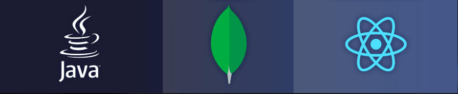

#  Full-Stack Developer 

  

# Estrela Marcolino

Computer Engineer 

# 👋 Olá!

Sou Engenheiro da Computação, com interesse no desenvolvimento de software, aplicações web e soluções tecnológicas.

Tenho experiência com desenvolvimento de APIs REST, aplicações backend, integração com bancos de dados e desenvolvimento Full Stack.

## 🚀 Tecnologias e ferramentas

### Backend
Java | Spring Boot | Spring Security | Node.js | Python | Kotlin

### Frontend
JavaScript | React | HTML5 | CSS3

### Banco de dados
PostgreSQL | MySQL | SQL

### Ferramentas
Git | GitHub | Docker | Maven | Postman

## 💻 Projetos em destaque

- **Sistema de Saúde e Bem-Estar-APLICATIVO:  Java, Spring Boot, PostgreSQL e JWT.
- **World Fashion Models (WFM)-SOFTWARE patentiado: HTML,CSS, React, Node.js e APIs REST.
- **ECO FOOD-aPLICATIVO:java,Spring boot,postgreSQL e JWT.
- **Robô de sinal Trading-pyhton(100%).
- **Robô de arbitragem Trading-python(100%).
